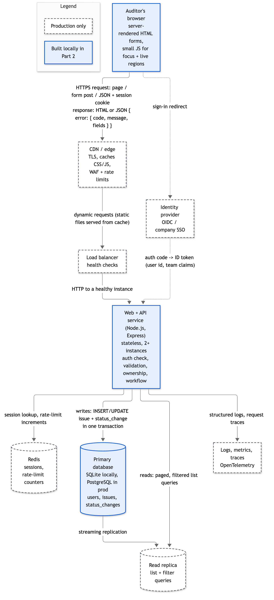
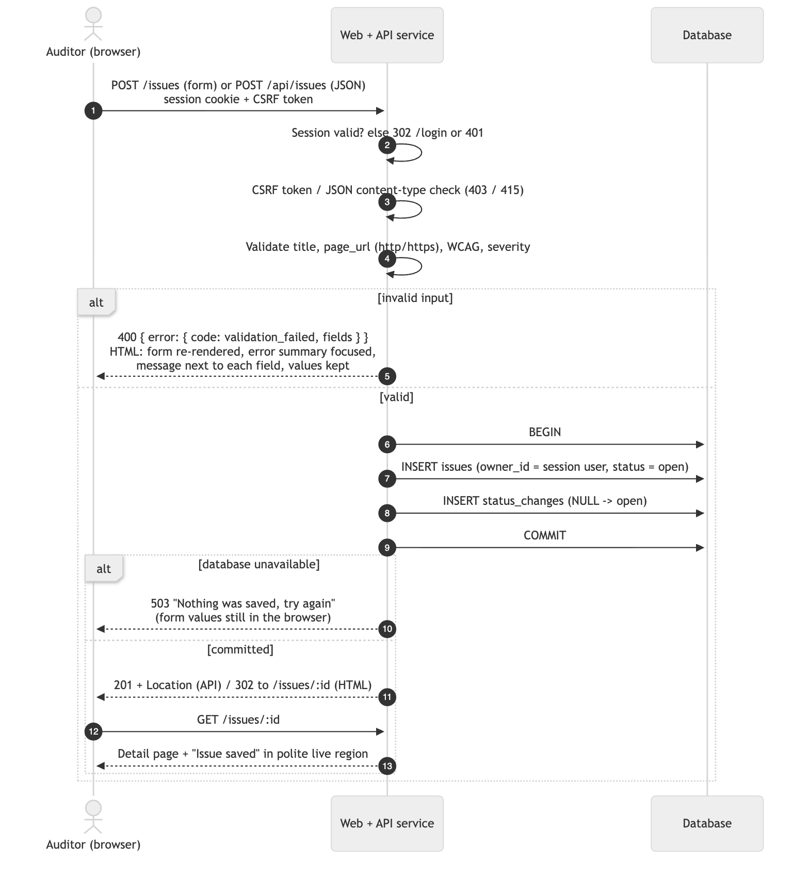
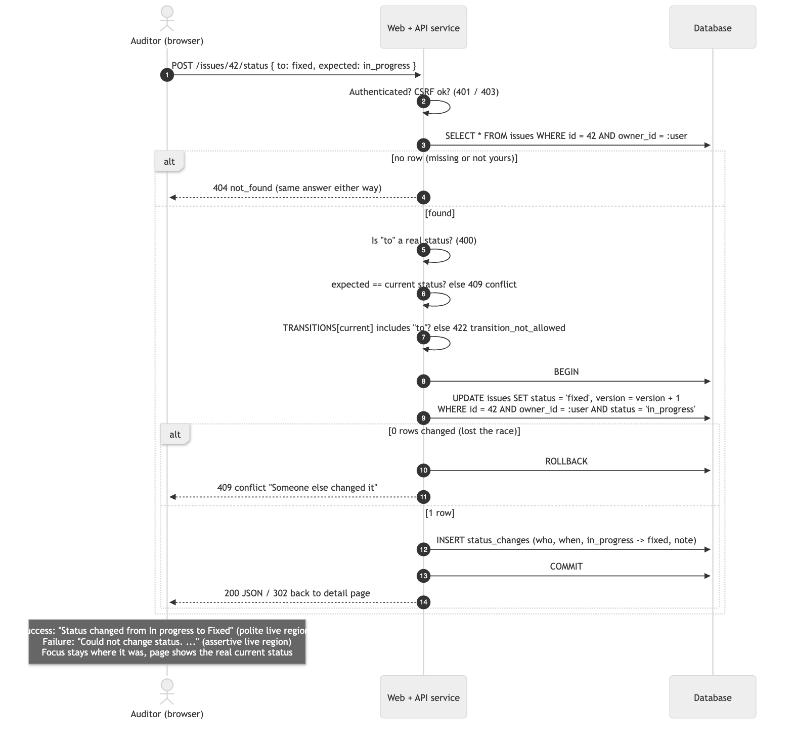
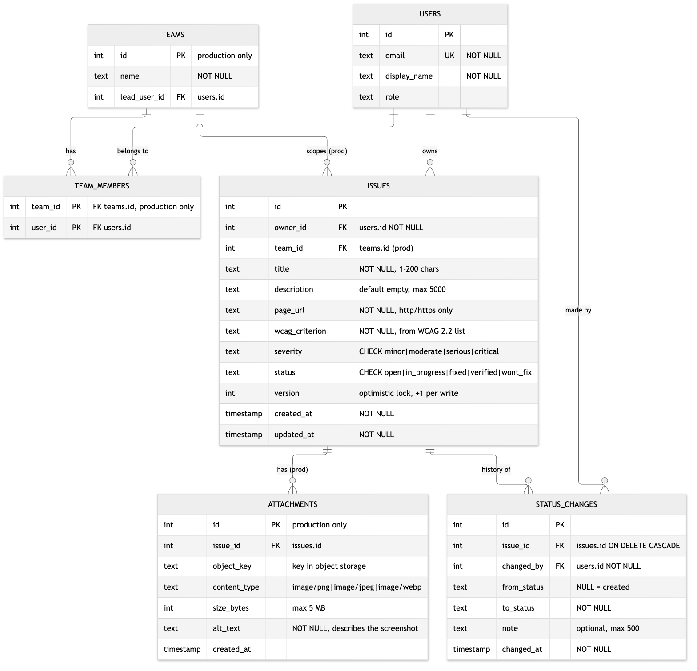
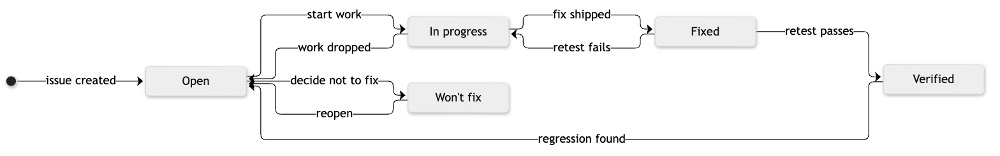
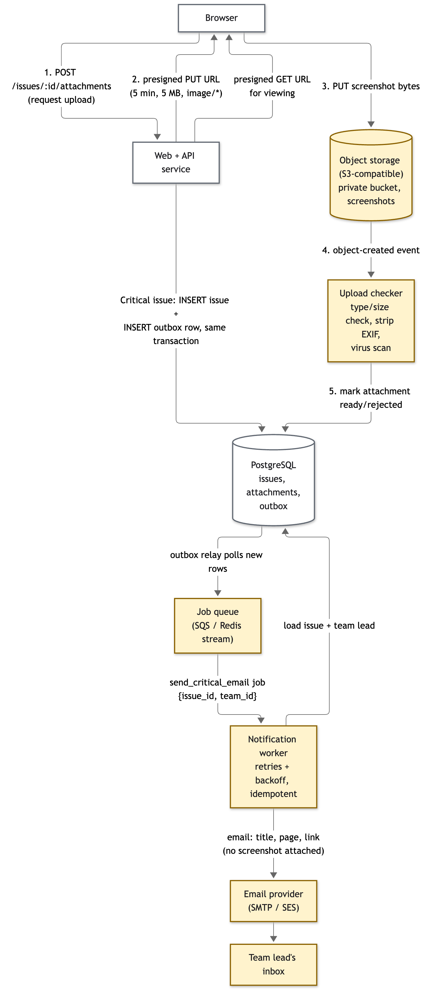

# Architecture

This document describes how I would run the audit tracker in production for about 500 teams (around 20,000 users and up to 1 million issues), and how the small local build in this repo maps onto that design.

**Diagram tool:** all diagrams are written in [Mermaid](https://mermaid.js.org/) (`docs/diagrams/*.mmd`) and exported to PNG with `@mermaid-js/mermaid-cli`. To regenerate them, run `cd tools && npm install && npm run diagrams`. I chose Mermaid because the diagrams live next to the code as text, so they show up in diffs and are easy to keep in sync with the schema.

## 1. Architecture diagram

Solid blue boxes are what Part 2 builds. Dashed boxes exist only in production.

| Component | Why it is there |
|---|---|
| Browser | Server-rendered HTML with native forms. JavaScript is only used to move focus to the error summary and to fill the live regions, so the app still works if a script fails to load. |
| CDN / edge | Terminates TLS, caches the static CSS/JS, and applies a WAF and per-IP rate limits before traffic reaches the app. |
| Load balancer | Spreads requests across at least two app instances and removes unhealthy ones. |
| Identity provider | Company SSO over OIDC. The app never stores passwords. Locally this is replaced by the two demo accounts. |
| Web + API service | One Node.js/Express codebase that serves both the HTML pages and the JSON API. It is stateless, so it scales horizontally. All validation, ownership checks and workflow rules run here, in one service layer (`src/issues.js`) that both the pages and the API call. |
| Redis | Shared session store and rate-limit counters, so any instance can serve any request. Locally the session is a signed cookie. |
| Primary database | PostgreSQL in production, SQLite locally. The schema is the same apart from types. All writes go here. |
| Read replica | Takes the list and filter queries off the primary. Detail pages read from the primary straight after a write, so users always see their own changes. |
| Logs / metrics | Structured logs and traces, used for alerting on error rates and slow queries. |

I left out a queue and object storage from the base design because nothing in the current requirements needs them. They appear in section 7, where they become necessary.

## 2. Request flows

### Creating an issue

1. The browser posts the form (`POST /issues`) or JSON (`POST /api/issues`) with the session cookie. HTML forms also carry a CSRF token. JSON writes must have `Content-Type: application/json`, which a cross-site form cannot send.
2. **Authentication:** if there is no valid session, page requests are redirected to sign in and API requests get `401`.
3. **Validation (server side):** title is required (max 200 chars), page URL must parse with the WHATWG `URL` parser and be `http:` or `https:`, the WCAG criterion must be one of the WCAG 2.2 A/AA criteria, and severity must be one of four values. The database also has `CHECK` constraints as a last line of defence.
4. **Authorisation:** there is nothing to check on create beyond being signed in. `owner_id` always comes from the session and never from the request body.
5. **Database write:** one transaction inserts the issue with status `open` and a first `status_changes` row (`NULL → open`), so the history is complete from the start.
6. **Success:** the API returns `201` with a `Location` header. The HTML flow redirects to the new issue's page, where "Success: Issue saved: …" appears at the top and is announced through a polite live region.
7. **Failure:** validation errors return `400` with a message for each field. The page re-renders with the typed values kept, an error summary at the top that gets focus, and a message next to each invalid field. If the database is down, nothing is saved, the user gets a plain "Nothing was saved, please try again" page (`503` in production), and the browser's back button still has their input.

### Changing an issue's status

1. The browser sends `POST /api/issues/:id/status` with `{ to, expected, note? }`. The HTML form posts the same thing to `POST /issues/:id/status`, with the fields named `status`, `expected` and `note`. `expected` is the status the user was looking at, sent as a hidden field.
2. The issue is loaded with `WHERE id = ? AND owner_id = ?`. If no row comes back the answer is `404`, whether the issue does not exist or belongs to someone else.
3. Three checks run in order: `to` must be a real status (`400`), `expected` must equal the current status (`409`, someone else changed it), and the move must be in the transition table (`422`, with a sentence explaining why and what *is* allowed).
4. In one transaction: `UPDATE issues SET status = :to, version = version + 1 WHERE id = :id AND owner_id = :user AND status = :from`, then insert the `status_changes` row with who, when, from, to and an optional note. If the update touched 0 rows, another request won the race, so the transaction rolls back and the user gets `409`.
5. **Success:** the user is redirected back to the issue. "Status changed from In progress to Fixed" is announced politely, and the new row appears in the history table.
6. **Failure:** the page reloads with the real current status, and the reason is shown in a red message box and announced through an assertive live region.

In both cases the redirect goes to `#status-heading`, so after the reload the user is back at the "Change status" section they were using, not at the top of the page. The message itself is announced from the live region, so the user does not have to go and find it.

## 3. Data model

`users`, `issues` and `status_changes` exist locally (see `src/db.js`). `teams`, `team_members`, `issues.team_id` and `attachments` are production additions.

Status changes are an append-only log in `status_changes`. The current status is also kept on `issues.status` so that list queries do not have to aggregate the log. Both are written in the same transaction, so they cannot drift apart. Creating an issue writes a row with `from_status = NULL`.

`version` is used for optimistic locking on edits: the edit form carries the version it was loaded with, and the update only applies if it still matches.

**Indexes**

| Index | Reason |
|---|---|
| `issues (owner_id, updated_at DESC)` | The default list page: "my issues, newest first", paged. Without it every page load scans and sorts the user's rows. |
| `issues (owner_id, status, updated_at DESC)` | Filtering by status is the most common filter ("show me everything Open"). An equality on two columns plus the sort order means the database can read one page straight off the index. |
| `issues (owner_id, severity, updated_at DESC)` | Same reasoning for the severity filter. When both filters are set, the status index is used and severity is checked on the few rows that remain. |
| `status_changes (issue_id, changed_at)` | Loads one issue's history in order without scanning a table that grows faster than `issues`. |
| `users (email)` unique | Lookup on sign-in, and it stops the same person being created twice. |

In production, where lists are scoped by team, the leading column becomes `team_id` instead of `owner_id`.

## 4. API

All responses are JSON. Errors always look like `{ "error": { "code": "…", "message": "…", "fields": { "title": "…" } } }`.

| Method | Path | What it does | Who may call | Errors |
|---|---|---|---|---|
| POST | `/api/session` | Sign in as a demo user (local only; OIDC callback in production) | anyone | 400, 415 |
| DELETE | `/api/session` | Sign out | anyone | – |
| GET | `/api/me` | Current user | signed in | 401 |
| GET | `/api/issues?status=&severity=&page=` | Paged list of the caller's issues, newest first | signed in, own issues only | 400 (bad filter), 401 |
| POST | `/api/issues` | Create an issue (status starts as `open`) | signed in | 400, 401, 413, 415 |
| GET | `/api/issues/:id` | One issue plus its status history | owner | 401, 404 |
| PATCH | `/api/issues/:id` | Edit title, description, URL, criterion, severity. Optional `version` for optimistic locking | owner | 400, 401, 404, 409, 415 |
| POST | `/api/issues/:id/status` | Body `{ to, expected?, note? }`. Change status through the workflow | owner | 400, 401, 404, 409 (stale), 422 (not allowed), 415 |

The HTML routes (`/issues`, `/issues/new`, `/issues/:id`, `/issues/:id/edit`, `/issues/:id/status`) call exactly the same service functions.

**Where ownership is enforced.** In the data access layer, not in the route handlers. Every query in `src/issues.js` takes the signed-in user's id and includes `owner_id = ?` in the SQL. There is no function that loads an issue by id alone, so a new route cannot forget the check. Someone else's issue returns `404` rather than `403`, so the API does not reveal which ids exist. In production this check becomes "the caller is a member of the issue's team". The same idea applies, with the team list read from the session. PostgreSQL row-level security could be added as a second layer.

## 5. Status workflow

| From | Allowed to |
|---|---|
| Open | In progress, Won't fix |
| In progress | Fixed, Open |
| Fixed | Verified, In progress |
| Verified | Open |
| Won't fix | Open |

**Blocked example: Open → Verified.** Verifying means a retest confirmed the fix, and an issue that was never marked Fixed has nothing to retest. Allowing it would let issues be closed without anyone fixing them, which defeats the point of an audit. The API answers `422` with: *"An issue cannot move from Open to Verified. It has to be marked Fixed before anyone can verify the fix."* Moving to the same status is also rejected.

The detail page only offers the moves that are allowed, but the backend does not trust that. The tests send disallowed moves straight to the API.

**Two people changing the same issue at once.** Every status change says which status it expects to move *from*, and the `UPDATE … WHERE status = :from` is a compare-and-set. If two requests both start from "In progress", one of them changes the row and the other updates 0 rows, so it gets `409 Conflict`: "This issue is now Fixed, not In progress. Someone else changed it." Nothing is silently overwritten, and the log only records the change that actually happened. Edits to the other fields use the same idea through the `version` column. Locally only the owner can touch an issue, but two browser tabs give the same race. `test/status.test.js` covers the stale `expected` case, and `test/validation.test.js` covers two tabs editing the same issue. The `WHERE status = :from` guard is a backstop for production, where several app instances can run the check-then-update at the same moment. Locally, one Node process and SQLite's single writer mean that path cannot be reached in a test without stubbing.

## 6. Scale and reliability

The numbers are modest: 1 million issues is a few GB, and "hundreds of issues in a minute" is a few writes per second. A single PostgreSQL primary handles that easily. The risks are in how the data is read.

**What gets slow first** is the list page. It counts and sorts a team's issues on every load, and `OFFSET` pagination gets slower the deeper you go. What I would do:

- Composite indexes that match the filters and the sort (section 3), so each page is an index range read.
- Keyset pagination in production (`WHERE (updated_at, id) < (:last_updated, :last_id) LIMIT 25`) instead of `OFFSET`. The local build uses `OFFSET` with a page size of 20, which is fine at this size.
- A capped or estimated total count for big teams ("more than 1,000 issues") instead of an exact `COUNT(*)`.
- List reads go to the replica. Writes and the page you land on right after a write read from the primary.
- `status_changes` grows fastest. It is append-only and indexed by `issue_id`, and can be partitioned by month later if it gets large.

**The burst after an audit.** Hundreds of creates in a minute mostly arrive as many single requests from one or two people, or from an import script. Each create is one short transaction with two inserts, so the database is not the bottleneck. The things to protect are fairness and duplicates. I would add a bulk endpoint (`POST /api/issues:batch`, up to 100 per request, one transaction) for import tools, rate limits per user at the edge, and an `Idempotency-Key` header so a retried import does not create duplicates. I would not put creates behind a queue: users expect to see the issue straight away, and the write is cheap.

Caching: static assets are cached at the CDN. I would not cache issue lists, because they change constantly, are different for every user, and are already fast once indexed.

**If the database is briefly unavailable:** the app instances stay up and their health checks report "degraded". Requests that need the database fail fast (short connection and statement timeouts) with `503` and a `Retry-After` header, instead of hanging. The page says "Nothing was saved. Please try again in a moment." Because each change is a single transaction, a failure never leaves half an issue or a status change without its log row. The connection pool retries with backoff. Managed PostgreSQL with a synchronous standby fails over in under a minute, and point-in-time recovery covers anything worse. Reads could keep working from the replica while writes are down, and I would make that explicit in the UI.

## 7. New requirement: screenshots and Critical-issue emails

Highlighted boxes are new.

**Screenshots.** Add **object storage** (S3-compatible, private bucket), an `attachments` table, and a small **upload checker**. The browser asks the API for an upload, and the API checks ownership and returns a short-lived presigned PUT URL limited to images under 5 MB. The browser uploads the file straight to storage, so large files never pass through the app servers. An object-created event triggers the checker, which confirms the real file type, strips EXIF metadata (it can contain location and device data), runs a virus scan, and marks the attachment ready. Images are shown through short-lived presigned GET URLs. Each attachment needs **alt text**, which is a required field on the upload form. An accessibility tool that stores inaccessible screenshots would be a bad look.

**Email to the team lead.** Add a **job queue**, a **notification worker** and an **email provider**. The email must not slow down the request or be lost, so the API does not send it. When a Critical issue is created, the same database transaction that inserts the issue also inserts a row into an `outbox` table. A relay publishes new outbox rows to the queue, and the worker sends the email with retries and backoff. The outbox means there is never an email for an issue that was rolled back, and never a committed Critical issue without an email. The worker is idempotent (keyed on issue id), so a retry does not send twice. The request returns as soon as the transaction commits. The email contains the title, the page, and a link, but no screenshot, because attachments can contain customer data.

## 8. Accessibility in the design

Messages start in the **service layer**. Every rule that can fail (validation, workflow, conflicts, not found) throws an `AppError` with an HTTP status, a stable `code` for programs, a `message` written as a full sentence for a person, and optional `fields` for each input. The messages say what to do, not only what went wrong ("Enter a full web address starting with http:// or https://, for example https://example.com/page.").

The frontend turns these into accessible output in three ways:

- **Field errors (`400` with `fields`):** the form re-renders with an error summary at the top (a heading, then a list of links to each field, in the same order as the form). Each invalid input gets `aria-invalid="true"`, and the inline message is linked with `aria-describedby`, so a screen reader reads the label, the error and the hint together. The page title gets an "Error:" prefix, and `public/app.js` moves focus to the summary.
- **Results of an action ("Issue saved", "Could not change status …"):** these go into a flash message that survives one redirect. The layout always has two empty live regions in the page, `role="status"` (polite) and `role="alert"` (assertive). After the page loads, the script copies the message text into the right one. Screen readers announce changes to a live region that already exists far more reliably than one that appears with the page. The script does not move focus. (After a status change the page reloads at the "Change status" section, see section 2.) The same message is also visible on screen.
- **Status and severity** are always shown as words. Badge colours are only a second cue.

A JSON client gets the same `message` strings, so a future fetch-based frontend can put `error.message` into the same live regions and map `error.fields` onto inputs without inventing new wording.

## 9. Technology choices

| | Local (Part 2) | Production |
|---|---|---|
| Backend | Node.js 22+ with Express 4 | Same |
| Frontend | Server-rendered EJS templates, native HTML controls, about 30 lines of JS | Same, served behind a CDN |
| Database | SQLite through `better-sqlite3`, a single file in `data/` | Managed PostgreSQL with a read replica |
| Sessions / auth | Signed cookie holding the demo user id | OIDC with company SSO, sessions in Redis |

**Alternative considered: React SPA instead of server-rendered pages.** A SPA would make filtering and status changes feel instant, with no full page reload. The cost is that I would have to rebuild what the browser gives for free on a page load: moving focus on route change, updating the document title, announcing new content, and handling the back button. Every one of those is a common accessibility bug. For a forms-and-tables app, server rendering gives correct behaviour with much less code, and it is easier to review in five hours. If the product grew, I would add small interactive pieces (for example inline status changes over the JSON API) rather than rewrite it.

**Why local and production differ.** SQLite needs no server, so a reviewer can run `npm install && npm start` and nothing else. It is also a real SQL database with transactions, foreign keys and `CHECK` constraints, so the logic is the same. It does not suit many app instances writing over a network, which is why production uses PostgreSQL. The SQL is kept portable (no SQLite-only features apart from `INSERT OR IGNORE` in the seed script), so moving over is mostly a change of driver and column types.
